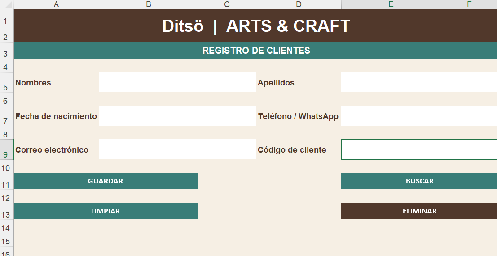
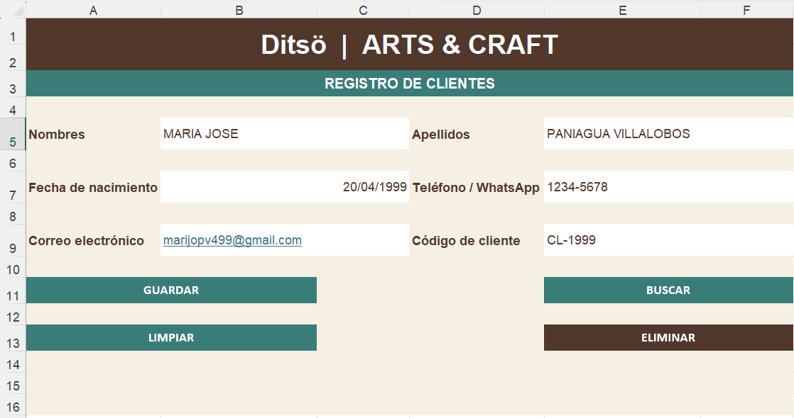
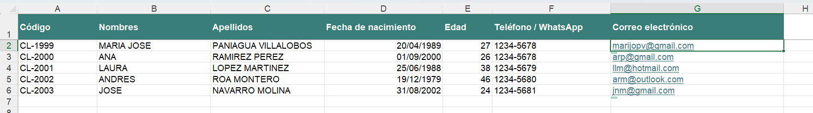
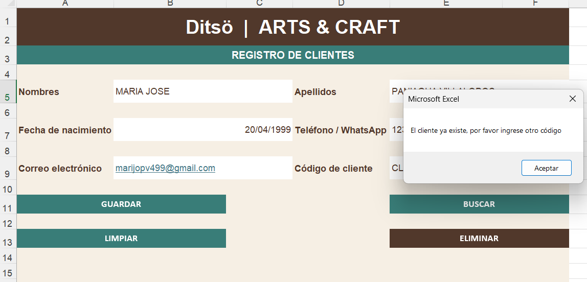
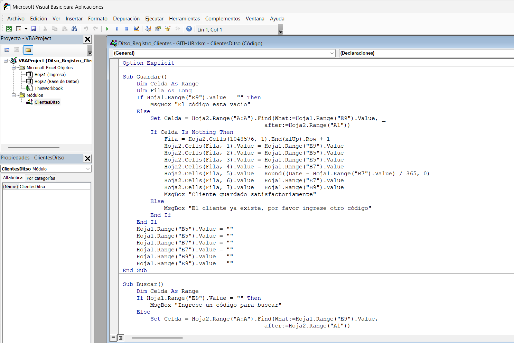

# Ditsö Arts & Craft | Sistema de gestión de clientes

[English](README.md) | Español

## Descripción del proyecto

Sistema de gestión de clientes desarrollado mediante Microsoft Excel y Visual Basic for Applications (VBA), diseñado para Ditsö Arts & Craft, emprendimiento especializado en figuritas de yeso cerámico, souvenirs y kits de pintura.

Este proyecto transforma un ejercicio académico de programación en una aplicación empresarial práctica, combinando automatización de procesos, gestión estructurada de datos y una interfaz personalizada.

## Objetivos

- Automatizar el registro y gestión de clientes.
- Reducir errores de ingreso manual.
- Prevenir identificadores duplicados.
- Facilitar la consulta de información.
- Aplicar conocimientos de VBA a un escenario empresarial real.

## Funcionalidades

| Función | Descripción |
|---|---|
| Guardar | Registrar nuevos clientes |
| Buscar | Recuperar información mediante un código único |
| Limpiar | Restablecer el formulario |
| Eliminar | Eliminar registros existentes |
| Validación | Detectar códigos vacíos y duplicados |
| Cálculo de edad | Estimar automáticamente la edad |
| Interfaz personalizada | Identidad visual de Ditsö Arts & Craft |

## Demostración visual del sistema

### Interfaz de registro de clientes

Formulario personalizado en Excel, diseñado con la identidad visual de Ditsö Arts & Craft.

### Registro de clientes

Ingreso de información mediante un formulario estructurado y automatizado con macros VBA.

### Base de datos

Almacenamiento estructurado de los registros de clientes en una hoja de cálculo independiente.

### Validación de códigos duplicados

Validación automática para evitar el registro de clientes con identificadores duplicados.

### Código fuente VBA

Implementación de procedimientos automatizados mediante Visual Basic for Applications.

## Tecnologías utilizadas

- Microsoft Excel
- Visual Basic for Applications (VBA)
- Macros de Excel
- Programación estructurada
- Gestión de datos
- Automatización de procesos

## Arquitectura del sistema

La aplicación está compuesta por dos hojas de cálculo:

### Ingreso

Interfaz personalizada para registrar, buscar, limpiar y eliminar información de clientes.

### Base de Datos

Hoja estructurada para almacenar los siguientes campos:

| Campo | Descripción |
|---|---|
| Código | Identificador único del cliente |
| Nombres | Nombres del cliente |
| Apellidos | Apellidos del cliente |
| Fecha de nacimiento | Fecha de nacimiento |
| Edad | Edad estimada automáticamente |
| Teléfono | Número de contacto |
| Correo electrónico | Dirección de correo electrónico |

## Conceptos de VBA aplicados

- Declaración de variables.
- Tipos de datos Range y Long.
- Estructuras condicionales.
- Método Find y propiedad Offset.
- Manipulación de celdas y filas.
- Programación modular.
- Reutilización de procedimientos.
- Validación de datos.
- Mensajes de notificación.

## Operaciones CRUD

| Operación | Estado |
|---|---|
| Create - Crear | Implementada |
| Read - Consultar | Implementada |
| Update - Actualizar | Planificada |
| Delete - Eliminar | Implementada |

## Instalación y uso

1. Descargar el archivo de Excel habilitado para macros (.xlsm).
2. Abrirlo en Microsoft Excel de escritorio.
3. Revisar el código fuente VBA.
4. Habilitar las macros si se confía en el archivo.
5. Utilizar los botones disponibles en el formulario.

## Mejoras futuras

- Actualización de registros existentes.
- Generación automática de códigos.
- Mayor precisión en el cálculo de edad.
- Confirmación previa a la eliminación.
- Validaciones adicionales de datos.

## Contexto académico

Proyecto desarrollado como parte de mi formación en programación VBA y adaptado a un emprendimiento real.

Se conservaron las macros originales del ejercicio académico como base de aprendizaje, incorporando una interfaz personalizada y la instalación automatizada de botones.

## Privacidad de los datos

La versión pública del proyecto debe contener exclusivamente información ficticia de clientes.

## Autora

**María José Paniagua Villalobos**

Estudiante de Análisis de Datos | Estudiante de Administración de Negocios | Emprendedora

Costa Rica - 2026

---

